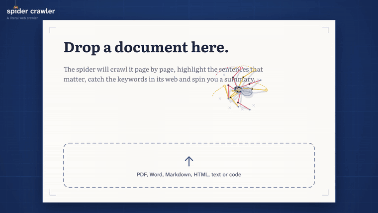
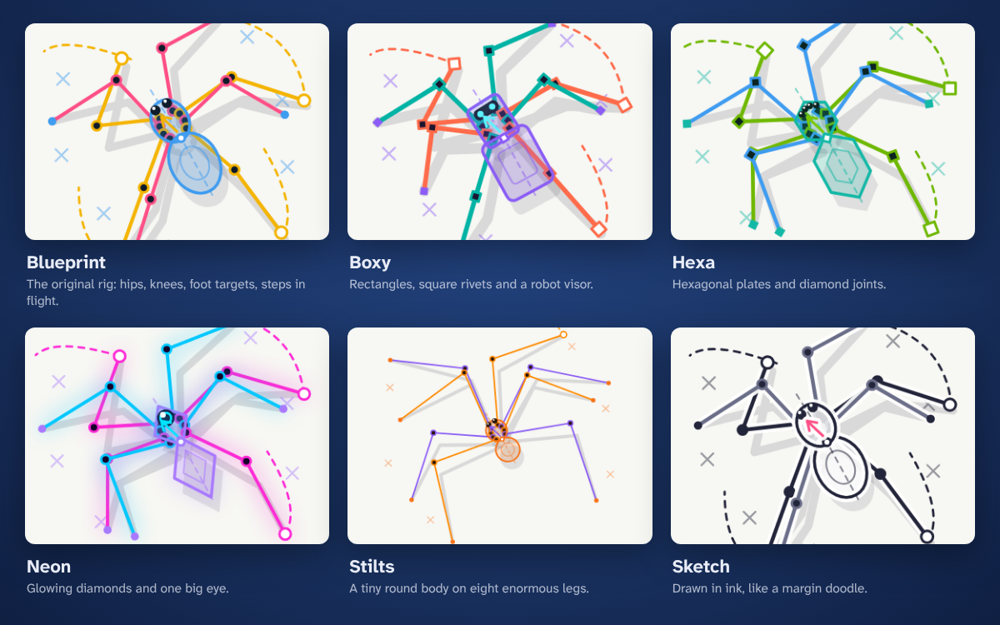

<p align="center">
  
</p>

<h1 align="center">Spider Crawler</h1>

<p align="center">
  <b>Un web crawler, au sens propre.</b><br>
  Dépose un document ou un lien. Regarde une araignée le lire. Récupère l'essentiel.
</p>

<p align="center">
  <a href="https://lulu38m.github.io/spider-crawler/"><b>Essayer dans le navigateur</b></a>
  &nbsp;&nbsp;|&nbsp;&nbsp;
  <a href="docs/demo.mp4">Vidéo de démo</a>
  &nbsp;&nbsp;|&nbsp;&nbsp;
  <a href="#installer">Installer</a>
  &nbsp;&nbsp;|&nbsp;&nbsp;
  <a href="README.md">English</a>
</p>

---

Spider Crawler est une araignée qui lit tes documents à ta place. Donne-lui un PDF, un Word, du Markdown, une page web ou un fichier de code : elle descend en rappel sur la première page, parcourt les lignes, **surligne les phrases importantes**, **emballe les mots-clés dans de la soie** et les rapporte dans sa toile. De temps en temps, elle fait tomber un mot de la page en passant. À la fin, elle tisse une toile et **écrit le résumé en fil de soie**.

C'est un jouet, mais honnête : tout ce que fait l'araignée à l'écran est la vraie analyse. Les surlignages jaunes sont les phrases du résumé, les cocons sont les mots-clés.

- 🕷️ **Animation procédurale, zéro keyframe** : cinématique inverse à deux segments pour chacune des huit pattes, démarche tétrapode (quatre pattes levées, puis les quatre autres), sauts entre les pages, fil de sécurité. L'araignée est dessinée comme son propre squelette.
- 📄 **Lit de vrais fichiers** : PDF (rendu fidèle via pdf.js), Word (.docx), Markdown, HTML, texte et plus de 40 langages de programmation.
- 📸 **Lit les photos et les scans** : photographie un courrier, colle une capture d'écran ou dépose un PDF scanné ; l'OCR tourne dans ton navigateur et l'araignée marche sur ta photo.
- 🔗 **Lit aussi les liens** : articles, PDF en ligne, README GitHub, pages Wikipédia.
- ❓ **Pose une question à l'araignée** (« quand ça se renouvelle ? », « quel est le chiffre d'affaires ? ») : elle court jusqu'au passage qui répond et le surligne en vert. Ça marche hors ligne ; avec une clé IA, la réponse est en plus reformulée.
- 🚩 **Lit les CGU que personne ne lit** : conditions générales, politiques de confidentialité, contrats. L'araignée attrape en rouge les clauses à lire (reconduction tacite, engagement, résiliation, frais, remboursement, partage de données, droits sur vos contenus, arbitrage…).
- 📈 **Lit les rapports financiers** : communiqués de résultats, rapports annuels, notes d'analyste. L'araignée attrape les chiffres clés (chiffre d'affaires, résultat net, marges, BPA…) avec leur variation et leur période.
- 🔒 **Privé par défaut** : les fichiers sont lus dans ton navigateur. Pas d'envoi, pas de compte, pas de clé API.
- ✨ **Résumé IA optionnel** avec ta propre clé : Claude ou toute API compatible OpenAI (OpenAI, Ollama, LM Studio, OpenRouter…).
- 🎬 **Pensé pour la vidéo** : enregistreur intégré en 1920×1080, **1080×1920 pour TikTok, Reels et Shorts**, ou 1080×1080, **avec le son**.
- 🔊 **ASMR inclus** : petits pas sur le papier, fil de soie qui se déroule, « pop » quand un mot tombe, une note pour chaque mot-clé attrapé (ça joue une petite mélodie). Tout est synthétisé en direct, sans fichier audio. <kbd>M</kbd> coupe le son.
- 🦾 **Six araignées** : Blueprint, Boxy, Hexa, Neon, Stilts et Sketch.
- 🌍 **Six langues** pour les résumés : français, anglais, espagnol, allemand, italien, portugais.

<p align="center"></p>

## Installer

Choisis la plus simple pour toi, c'est la même app partout.

| | Comment | Pour |
| --- | --- | --- |
| **1. Rien à installer** | Ouvre **[lulu38m.github.io/spider-crawler](https://lulu38m.github.io/spider-crawler/)** | Essayer. Tes fichiers ne quittent pas ton navigateur. |
| **2. Une commande** | `npx @lulu38m/spider-crawler` | Lire n'importe quel lien. Nécessite [Node.js 22+](https://nodejs.org). |
| **3. Docker** | `docker run --rm -p 8080:8080 ghcr.io/lulu38m/spider-crawler` | Un serveur, un home lab, le partager sur ton réseau. |
| **4. Télécharger et double-cliquer** | Récupère le zip dans les [Releases](https://github.com/lulu38m/spider-crawler/releases), puis ouvre `start.command` (Mac) ou `start.bat` (Windows) | Sans terminal. Nécessite Node.js 22+. |
| **5. Depuis les sources** | `git clone`, `npm install`, `npm run dev` | Modifier le code. |

La version en ligne de commande accepte directement un fichier ou un lien :

```bash
npx @lulu38m/spider-crawler                          # ouvre l'app
npx @lulu38m/spider-crawler ~/Documents/memoire.pdf  # lit un fichier
npx @lulu38m/spider-crawler https://example.com/post # lit une page web
```

Sur Mac, si macOS refuse d'ouvrir `start.command` : clic droit, **Ouvrir**, puis **Ouvrir** encore (une seule fois).

## Lire un lien

Colle un lien dans le champ de l'écran d'accueil, n'importe où sur la page, glisse-le depuis un autre onglet, ou ouvre `?url=https://…`.

Les navigateurs n'autorisent une page à lire un autre site que si ce site l'accepte (CORS). La version en ligne lit donc ce qui lui est ouvert : fichiers et README GitHub, articles Wikipédia (via leurs API publiques), et les nombreux sites et PDF qui l'autorisent. Sinon, elle le dit clairement.

Les versions `npx`, Docker et zip embarquent un petit récupérateur local qui lit **n'importe quelle page publique**. Il ne sort que vers l'internet public (pas de `localhost` ni d'adresses du réseau local, vérifié à chaque redirection), s'arrête à 20 Mo et 15 secondes, et ne garde rien. Pour lire ton intranet, lance-le avec `--allow-private`.

## Photos, captures d'écran et scans

Prends en photo un courrier, colle une capture d'écran (<kbd>⌘</kbd>/<kbd>Ctrl</kbd>+<kbd>V</kbd> sur l'accueil) ou dépose un PDF scanné : l'araignée le lit par OCR et marche **sur ta photo elle-même**, en surlignant les vrais mots. Les modes finance et CGU marchent aussi sur les photos : un contrat photographié a ses clauses en rouge.

L'OCR, c'est [Tesseract](https://github.com/tesseract-ocr/tesseract) compilé en WebAssembly, en anglais et en français, dans ton navigateur. Le moteur et les modèles de langue (environ 15 Mo) sont servis par l'app elle-même, pas par un CDN, téléchargés à la première photo puis gardés en cache. Quelques secondes par page ; les PDF scannés sont lus jusqu'à 40 pages.

## Poser une question

Une fois un document ouvert, tape ta question dans la barre au-dessus des contrôles (ou appuie sur <kbd>/</kbd>). L'araignée descend jusqu'au passage qui répond, le lit et le surligne en vert ; une carte affiche la question et la réponse, dessinée sur le canvas, donc visible dans tes vidéos. <kbd>Échap</kbd> ramène à la toile.

La recherche se fait dans ton navigateur (BM25 sur les phrases, racines des mots, quelques synonymes français/anglais, bonus pour une date quand tu demandes « quand », un montant pour « combien »). Si rien ne correspond assez, elle le dit au lieu d'inventer. Avec une clé IA, seuls les passages trouvés sont envoyés avec la question, et la carte affiche une réponse courte.

## CGU et contrats

Quand un document ressemble à des CGU, une politique de confidentialité ou un contrat, l'araignée passe en mode CGU. Elle repère, à leur formulation, les clauses qu'on signe sans les lire : reconduction tacite, durée d'engagement, résiliation et préavis, frais et hausses de prix, absence de remboursement, partage et conservation des données, licence sur vos contenus, arbitrage et renonciation à l'action collective, responsabilité limitée, conditions modifiables à tout moment, fermeture du compte « à notre seule discrétion ».

Chaque clause est **surlignée en rouge**, attrapée dans un **cocon rouge** avec son détail (`Résiliation 29 €`, `Engagement 12 mois`), et listée dans le résumé sous **Clauses to read** avec une explication et la citation. Pour essayer : les CGU de Silkthread Cloud, un service qui n'existe pas.

L'araignée signale, elle ne juge pas : une clause signalée peut être tout à fait correcte. Ce n'est pas un avis juridique, c'est une raison de lire ce paragraphe.

## Rapports financiers

Quand un document ressemble à un rapport financier, l'araignée passe en mode finance : elle repère les **chiffres clés** tels que le document les écrit (chiffre d'affaires, résultat net, résultat opérationnel, EBITDA, marges, BPA, free cash-flow, dette nette, dividende, objectif de cours…), avec leur **variation** (`+7,2%`, `−4%`, `+70 bps`) et leur **période** (`Q3 2026`, `H1 2026`, `FY 2025`). Elle les attrape comme des mots-clés (`CA €1 234,5m +7,2%` sur la toile), et le résumé affiche un tableau **Key figures**, aussi présent dans l'export Markdown.

Rien n'est calculé ni deviné : un chiffre n'apparaît que si le document le donne, et l'app ne donne ni avis ni conseil. Pour essayer : le rapport de résultats d'Orbweaver Silkworks, une entreprise qui n'existe pas.

## Utiliser

Clique sur le logo en haut à gauche pour revenir à l'accueil.

**Raccourcis** : <kbd>Espace</kbd> pause, <kbd>←</kbd> <kbd>→</kbd> vitesse, <kbd>S</kbd> araignée suivante, <kbd>R</kbd> enregistrer, <kbd>K</kbd> aller au résumé, <kbd>M</kbd> son, <kbd>/</kbd> poser une question, <kbd>N</kbd> nouveau document.

## Faire une vidéo

**Dans l'app** : choisis le cadre 9:16, clique sur **Record**, puis dépose ton fichier. L'enregistrement s'arrête tout seul quelques secondes après le résumé et se télécharge en MP4 (ou WebM selon le navigateur).

**Image par image, en ligne de commande** (aucune image perdue), depuis un clone du dépôt :

```bash
npx playwright-core install chromium   # une seule fois
npm run demo:render -- --file ~/Documents/memoire.pdf --frame 9:16 --out ma-video.mp4
```

Nécessite ffmpeg. Options : `--skin boxy`, `--speed 1.5`, `--frame 16:9|9:16|1:1`, `--mute`. La bande-son est calculée image par image : chaque pas tombe pile sur sa frame.

## Comment ça marche

Tous les formats deviennent la même chose : des pages, des lignes et des mots, chaque mot avec sa position sur la page et sa plage dans le texte brut. C'est ce qui permet à une phrase du résumé de retrouver ses pixels.

- **Le résumé** est extractif par défaut (les phrases sont celles du document) : TextRank classe les phrases que le reste du texte « approuve », la pertinence marginale maximale (MMR) retire les redites, et les mots-clés sont des suites de mots porteurs de sens entre mots vides.
- **La chorégraphie** : un « directeur » planifie la marche avant que l'araignée bouge. Elle lit en boustrophédon (aller-retour, comme un bœuf qui laboure), ralentit sur les phrases du résumé, survole le reste, attrape une occurrence de chaque mot-clé, saute d'une page à l'autre, et le tout tient dans un budget de temps.
- **L'araignée** : le corps poursuit un point cible, chaque patte reste posée jusqu'à trop s'éloigner de sa position de repos, puis fait un pas, en deux groupes alternés de quatre.
- **Les mots qui tombent** : toutes les quelques secondes, un mot que l'araignée vient de lire est découpé dans la page, saute, tombe en tournoyant, et le trou dans le papier se referme. Le tirage dépend du nom du document : le même fichier fait toujours tomber les mêmes mots.

## Déployer

Le dépôt contient trois workflows : **CI** (tests et build), **Pages** (publie l'app à chaque push sur `main` ; dans **Settings → Pages**, choisis **GitHub Actions**) et **Release** (sur un tag de version : zip prêt à l'emploi, image Docker sur `ghcr.io`, et paquet npm si le secret `NPM_TOKEN` existe).

Si tu forkes le projet, modifie `REPO_URL` dans `src/config.ts` : il s'affiche à la fin de chaque vidéo.

## Licence

[MIT](LICENSE)
