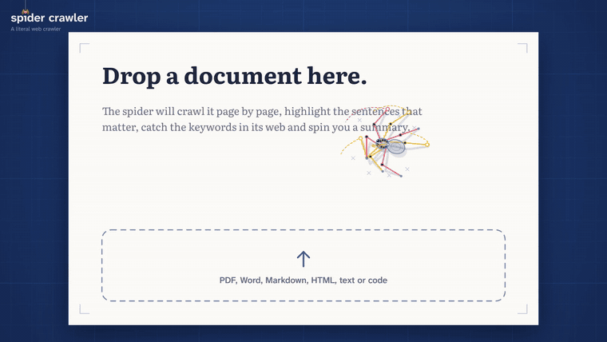
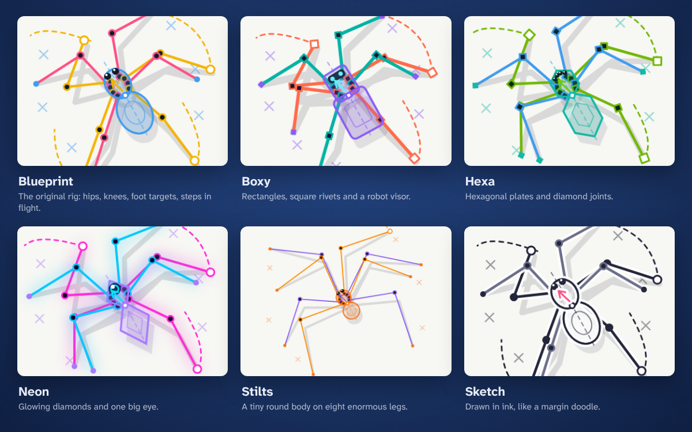
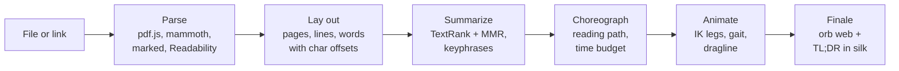

<p align="center">
  
</p>

<h1 align="center">Spider Crawler</h1>

<p align="center">
  <b>A literal web crawler.</b><br>
  Drop a document or a link. Watch a spider read it. Get the gist.
</p>

<p align="center">
  <a href="https://lulu38m.github.io/spider-crawler/"><b>Try it in your browser</b></a>
  &nbsp;&nbsp;|&nbsp;&nbsp;
  <a href="docs/demo.mp4">Full demo video</a>
  &nbsp;&nbsp;|&nbsp;&nbsp;
  <a href="#install">Install</a>
  &nbsp;&nbsp;|&nbsp;&nbsp;
  <a href="#how-it-works">How it works</a>
  &nbsp;&nbsp;|&nbsp;&nbsp;
  <a href="README.fr.md">Français</a>
</p>

<p align="center">
  <a href="LICENSE"></a>
  
  
  
  <a href="https://github.com/lulu38m/spider-crawler/actions/workflows/ci.yml"></a>
</p>

---

Spider Crawler is a spider that reads your documents for you. Give it a PDF, a Word file, Markdown, a web page or a source file: it rappels down onto the first page, walks the lines, **highlights the sentences that matter**, **wraps the keywords in silk** and carries them to its web. Now and then it knocks a word off the page on its way. At the end it builds an orb web and **writes the summary in silk**.

It's a toy, but an honest one: everything the spider does on screen is the real analysis. The yellow highlights are the summary sentences. The cocoons are the keywords. Nothing is faked for the animation.

- 🕷️ **Procedural animation, zero keyframes.** Two-bone inverse kinematics for each of the eight legs, a tetrapod gait (four legs up, then the other four), jumps between pages, a dragline behind it. The spider is drawn as its own rig, so you see how it works.
- 📄 **Reads real files.** PDFs keep their real look (rendered by pdf.js, with the spider walking on the actual words), plus Word (.docx), Markdown, HTML, plain text and 40+ programming languages.
- 🔗 **Crawls links too.** Paste a URL: articles, PDFs online, GitHub READMEs, Wikipedia pages.
- 📈 **Reads financial reports.** Earnings releases, annual reports and analyst notes get a finance mode: the spider catches the headline figures (revenue, net income, margins, EPS…) with their change and period.
- 🔒 **Private by default.** Files are read in your browser: no upload, no account, no API key. Works offline once loaded.
- ✨ **Optional AI summary.** Bring your own key for Claude or any OpenAI-compatible endpoint (OpenAI, Ollama, LM Studio, OpenRouter…). Requests go straight from your browser to the provider.
- 🎬 **Made for video.** A built-in recorder exports MP4/WebM at 1920×1080, **1080×1920 for TikTok, Reels and Shorts**, or 1080×1080. Or render frame-perfect videos from the command line.
- 🦾 **Six spiders.** Blueprint, Boxy, Hexa, Neon, Stilts and Sketch. Adding one is ten lines of data.
- 🌍 **Six languages** for summaries: English, French, Spanish, German, Italian, Portuguese.

<p align="center"></p>

## Install

Pick the easiest one for you. They all run the same app.

| | How | Good for |
| --- | --- | --- |
| **1. Nothing to install** | Open **[lulu38m.github.io/spider-crawler](https://lulu38m.github.io/spider-crawler/)** | Trying it. Files never leave your browser. |
| **2. One command** | `npx @lulu38m/spider-crawler` | Crawling any link. Needs [Node.js 22+](https://nodejs.org). |
| **3. Docker** | `docker run --rm -p 8080:8080 ghcr.io/lulu38m/spider-crawler` | Servers, a home lab, sharing on your network. |
| **4. Download and double-click** | Get the zip from [Releases](https://github.com/lulu38m/spider-crawler/releases), then open `start.command` (Mac) or `start.bat` (Windows) | No terminal. Needs Node.js 22+. |
| **5. From source** | `git clone`, `npm install`, `npm run dev` | Hacking on it. |

The command line version takes a file or a link directly:

```bash
npx @lulu38m/spider-crawler                          # open the app
npx @lulu38m/spider-crawler ~/Documents/thesis.pdf   # crawl a file
npx @lulu38m/spider-crawler https://example.com/post # crawl a web page
npx @lulu38m/spider-crawler --help                   # --port, --host, --no-open…
```

<details>
<summary>From source</summary>

```bash
git clone https://github.com/lulu38m/spider-crawler.git
cd spider-crawler
npm install
npm run dev        # http://localhost:5173
```

`npm start` runs the built app like the `npx` command does (after `npm run build`).
</details>

<details>
<summary>On a Mac, macOS says it can't check start.command</summary>

That's Gatekeeper being careful with downloaded scripts. Right-click `start.command`, choose **Open**, then **Open** again. You only need to do it once.
</details>

## Crawling links

Paste a link in the field on the landing page, paste it anywhere on the page, drag it from another tab, or open `?url=https://…` directly.

Browsers only let a web page read another site if that site allows it (CORS). So the online version can crawl what's open to it: GitHub files and READMEs, Wikipedia articles (both read through their public APIs), and the many sites and PDFs that allow it. For everything else it tells you so.

The `npx`, Docker and zip versions come with a tiny local fetcher, so they can crawl **any public page**. It only reaches the public internet (no `localhost`, no private network addresses, checked again after every redirect), stops at 20 MB and 15 seconds, and keeps nothing. If you do want to crawl your intranet, start it with `--allow-private`.

Web pages are cleaned up with Mozilla's [Readability](https://github.com/mozilla/readability), like your browser's reader mode, so the spider reads the article, not the menus.

## Financial reports

When a document reads like a financial report (earnings release, annual or half-year report, analyst note), the spider switches to finance mode:

- it finds the **headline figures** as the document states them: revenue, net income, operating income, EBITDA, margins, EPS, free cash flow, net debt, orders, dividend, price target, P/E, and their outlook;
- each comes with its **change** (`+18%`, `−4%`, `+230 bps`) and **period** (`Q3 2026`, `H1 2026`, `FY 2025`);
- the spider **catches the figures** like keywords: on the web they read `Revenue $412.6m +18%`;
- the summary gets a **Key figures** table, the TL;DR is a sentence that states a result, and the Markdown export includes the table.

It reads English and French reports best (`$412.6 million`, `1 234,5 M€`, `en hausse de 7,2 %`), with the main metric names in Spanish, German, Italian and Portuguese too. Try it with the sample: an earnings report from Orbweaver Silkworks, a company that doesn't exist.

Nothing is computed or guessed: a figure only appears if the document says it, and the app gives no opinion or advice.

## Using it

Click the logo in the top left to come back to the start at any time.

| Key | Action |
| --- | --- |
| <kbd>Space</kbd> | Pause / play |
| <kbd>←</kbd> <kbd>→</kbd> | Slower / faster (½×, 1×, 2×, 4×) |
| <kbd>S</kbd> | Next spider |
| <kbd>R</kbd> | Start / stop recording |
| <kbd>K</kbd> | Skip to the summary |
| <kbd>N</kbd> | New document |
| <kbd>Esc</kbd> | Close the summary |

You can also paste text, a file or a link anywhere on the landing page.

## Make a video of your spider

**In the app:** pick a frame (9:16 for TikTok, Reels and Shorts), press **Record**, then drop your file. The recording stops by itself a few seconds after the summary is spun and downloads as MP4 (or WebM in browsers that can't record MP4). Everything is drawn on one canvas, so the video contains exactly what you see, HUD and finale included.

**Frame-perfect, from the command line:** no dropped frames, whatever your machine. From a clone of the repo:

```bash
npx playwright-core install chromium   # once
npm run demo:render -- --file ~/Documents/thesis.pdf --frame 9:16 --out my-video.mp4
```

Options: `--frame 16:9|9:16|1:1`, `--skin boxy`, `--speed 2`, `--sample arachnid-reading.pdf`, `--gif out.gif`. Needs ffmpeg on your PATH.

Deep links work too: `?sample=spider-silk.md&skin=neon&speed=2&frame=9:16`.

## How it works



**Every format becomes the same thing:** pages of lines and words, each word with a box on the page and a range in the plain text. That shared model is what lets a summary sentence find its way back to pixels: highlight a sentence, and the spider knows exactly which words to walk over.

**The summary** is extractive by default, so the sentences are the document's own words:
- sentences are ranked with [TextRank](https://aclanthology.org/W04-3252/): a graph where similar sentences vote for each other, so the sentences the rest of the document agrees with rise to the top;
- [maximal marginal relevance](https://dl.acm.org/doi/10.1145/290941.291025) removes near-duplicates so the summary doesn't say the same thing three times;
- keywords are runs of content words between stopwords ([RAKE](https://www.researchgate.net/publication/227988510_Automatic_Keyword_Extraction_from_Individual_Documents)-style), scored by frequency, length and cohesion;
- a few honest heuristics help: an explicit "Abstract" paragraph weighs more, short notes lead with their first sentence, and questions or sentences starting with "It" or "However" make poor summaries;
- source files get their own mode: declarations become the key lines, identifiers become the keywords.

It runs in a Web Worker in a few milliseconds for a typical article. Connect an AI provider to also get an abstractive rewrite.

**The choreography.** A director plans the walk before the spider moves. It reads lines back and forth like an ox ploughing a field (*boustrophedon*), slows down on summary sentences, skims the rest, stops to catch one occurrence of each keyword (spread across the document), jumps the gap to the next page and, for long documents, rappels past pages that have nothing to say. The whole plan is fitted to a time budget, so a 3-page article takes about 40 seconds and a 300-page report doesn't take an hour.

**The spider.** The body chases a goal point the director moves. Each foot stays planted until it drifts too far from where it would rest, then it steps, in two alternating groups of four: the tetrapod gait real spiders use. Knees come from an analytic two-bone IK solve, bending outward. The abdomen swings when it turns, the dragline is glued down at every turn, and old silk fades so the page stays readable. Open `/playground.html` in dev to play with the rig.

**Finance mode.** A report is detected by its vocabulary and its currency amounts. Each sentence is then matched against a small multilingual dictionary of metrics; the first amount after a metric (in the right unit: money, percent or per share) is its value, a signed or "up/down" percentage around it is its change, and the first period in the sentence (or the document) is its period. Sentences stating a figure weigh more in the summary.

**Falling words.** Every few seconds, as the spider passes a word, it knocks it loose: the word is cut out of the page bitmap, pops, tumbles off with a bit of spin and gravity, and the hole in the paper heals behind it. It's seeded by the document's name, so the same file always drops the same words, and it never touches a keyword the spider is about to catch.

**One canvas.** Pages, spider, silk, falling words, HUD and finale are all drawn on a single `<canvas>`. Pages are rasterized once and drawn as bitmaps, which keeps 60 fps recording cheap.

## Optional AI summaries

Click **AI summary** in the top right:

- **Claude:** paste an [Anthropic API key](https://console.anthropic.com/). The default model is `claude-haiku-5-5`.
- **OpenAI-compatible:** set the base URL and the model. For a fully local setup with [Ollama](https://ollama.com), use `http://localhost:11434/v1` and allow the page's origin, for example `OLLAMA_ORIGINS=https://lulu38m.github.io ollama serve`.

The key is stored in your browser's local storage and sent only to the provider you picked. Only the extracted text is sent, never the file.

## Supported files

| Format | Notes |
| --- | --- |
| PDF | Rendered with pdf.js; the spider walks on the real text layer. Scanned PDFs have no text yet (OCR is on the roadmap). |
| Word (.docx) | Converted with mammoth. Old .doc files: save as .docx first. |
| Markdown, text | Headings, lists, quotes and code blocks are typeset. |
| HTML and links | Cleaned up with Mozilla's Readability, like reader mode. |
| Source code | 40+ languages, with line numbers. Summary = declarations + most used identifiers. |

## Deploy your own

The repo ships with three workflows:

- **CI** (`ci.yml`): type-check, tests and build on every push and pull request.
- **Pages** (`deploy.yml`): publishes the app on every push to `main`. In **Settings → Pages**, choose **GitHub Actions** as the source.
- **Release** (`release.yml`): on a version tag (`npm version patch && git push --follow-tags`), it attaches the ready-to-run zip to a GitHub Release, pushes the Docker image to `ghcr.io` (amd64 and arm64) and, if you add an `NPM_TOKEN` secret, publishes the npm package.

The app itself is a static folder (`npm run build` → `dist/`), so any static host works.

If you fork it, change `REPO_URL` in [`src/config.ts`](src/config.ts): it's shown at the end of every video, so clips shared on social media point back to your repo.

## Project structure

```
src/
  doc/         parsers (PDF, Word, Markdown, HTML, text, code, links) and the page layout engine
  summarize/   offline summarizer (TextRank, MMR, keyphrases, languages, finance mode) and optional AI
  spider/      the procedural spider: IK solver, gait, skins, drawing
  scene/       camera, pages, director, silk, falling words, cocoons, orb web, HUD, finale
  ui/          recorder, Markdown export, share image
  app.ts       DOM wiring: inputs, controls, dialogs
server/        the local link fetcher (plain Node, no dependencies)
bin/           the `spider-crawler` command
scripts/       frame-perfect video renderer, sample PDF generators
tests/         summarizer, finance, layout, gait, director, falling words, links and fetcher tests (vitest)
```

About 7,000 lines of TypeScript, no UI framework, no runtime dependencies for the command line. `npm test` runs the suite, `npm run build` type-checks and builds.

## Roadmap

- OCR for scanned PDFs and images (tesseract.js)
- EPUB and OpenDocument
- More summary languages (stopword lists are tiny, see `src/summarize/stopwords.ts`)
- `npx @lulu38m/spider-crawler file.pdf --video` to render a video in one line
- More spiders. Yours?

## Contributing

Ideas, skins and fixes are welcome: see [CONTRIBUTING.md](CONTRIBUTING.md). Good first issues: a new spider skin, stopwords for your language, a new file format.

## Credits

Built with [pdf.js](https://mozilla.github.io/pdf.js/) (Apache-2.0), [mammoth](https://github.com/mwilliamson/mammoth.js) (BSD-2), [marked](https://marked.js.org) (MIT) and [Readability](https://github.com/mozilla/readability) (Apache-2.0). Typeset in [Literata](https://github.com/googlefonts/literata) and [Atkinson Hyperlegible](https://www.brailleinstitute.org/freefont/) (SIL Open Font License).

## License

[MIT](LICENSE)
